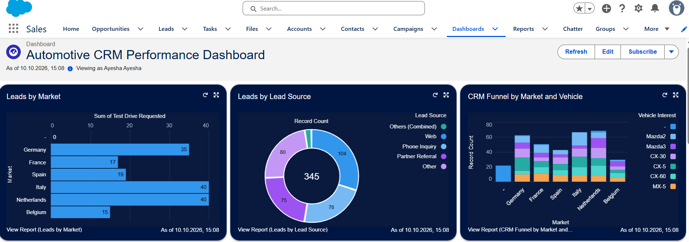
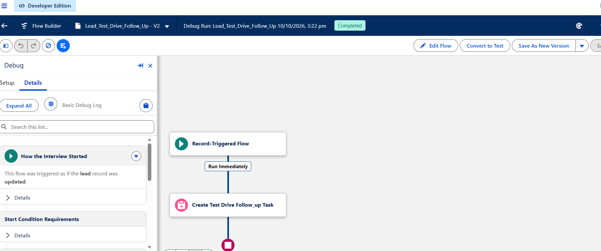
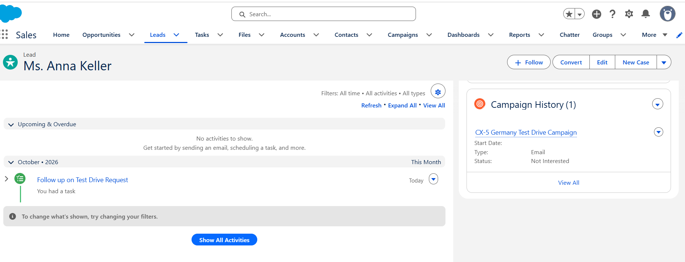

## CRM Dashboard

## Salesforce Flow Automation

## Flow Configuration

## Automated Follow-up Task

# Automotive CRM & Customer Data Quality — Salesforce

A hands-on Salesforce CRM project demonstrating customer data management,
CRM data quality, segmentation, campaign management, reporting, dashboards,
and workflow automation in an automotive use case.

## Project Overview

The project simulates a European automotive CRM environment in Salesforce
using synthetic customer and lead data.

The objective was to build an end-to-end CRM workflow covering:

Customer Data
→ Data Quality
→ Segmentation
→ Campaign Targeting
→ Response Tracking
→ Reporting
→ Automation

## Dataset

300 synthetic automotive leads containing:

- Customer details
- Market
- Vehicle interest
- Customer journey stage
- Test-drive request
- Preferred dealer
- Last interaction date
- Lead source and status

The dataset intentionally contains selected duplicates and missing values
for CRM data-quality testing.

## Salesforce Configuration

Custom Lead fields created:

- Vehicle Interest
- Market
- Customer Journey Stage
- Test Drive Requested
- Preferred Dealer
- Last Interaction Date

## CRM Data Quality

Implemented checks for:

- Missing email addresses
- Missing vehicle interests
- Stale leads
- Duplicate customer records
- Invalid field lengths and import errors

## Customer Segmentation

Built target segments using Salesforce List Views.

Example:

Germany
+ CX-5
+ Consideration/Test Drive stage

## Campaign Management

Created a targeted Salesforce campaign:

CX-5 Germany Test Drive Campaign

Campaign member statuses:

- Sent
- Responded
- Test Drive Booked
- Not Interested

## Reporting & Dashboard

Created Salesforce reports and dashboard components for:

- Leads by market
- Leads by vehicle interest
- Leads by lead source
- Customer journey stage
- Test-drive requests by market
- Vehicle interest by market
- Campaign performance

## Salesforce Flow Automation

Built a Record-Triggered Flow:

Test Drive Requested = True
→ Automatically create follow-up Task
→ Assign Task to Lead Owner
→ Link Task to Lead

## Technologies

- Salesforce CRM
- Salesforce Sales Cloud
- Salesforce Flow Builder
- Salesforce Reports & Dashboards
- Data Import Wizard
- Campaign Management
- CRM Data Quality
